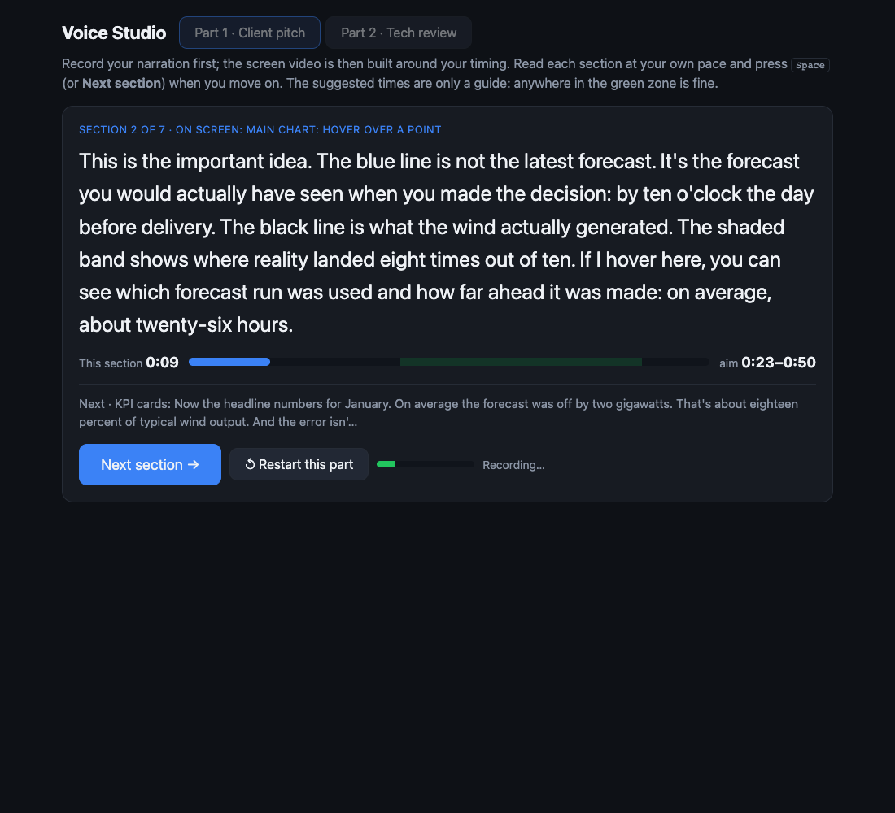

# voice-first-demo

Make a narrated product demo video by recording your **voice first** and letting the
**screen recording build itself around your timing**.

Usually you record the screen, then struggle to talk over it at the right moments. This
flips it. You read a script at your own pace, the tool notes when you move to each
section, and a headless browser then performs each scene for as long as you spoke about it.
The result: a 1080p video where the screen follows what you say, with no editing.



## How it works

```
script.md ──► Voice studio (teleprompter) ──► voice/<part>.webm + marks.json
                                                     │   (when each section began)
                                                     ▼
                         record.mjs: Playwright plays one scene per section,
                         stretching or squeezing its pauses to fit your timing
                                                     │
                                                     ▼
                         merge.sh: voice + video ──► final/demo.mp4
```

- **Voice studio** (`voiceover_server.py` + `voiceover.html`): a local teleprompter. It shows
  one section of `script.md` at a time, what will be on screen, and a suggested duration with a
  wide "anywhere here is fine" zone. Press <kbd>Space</kbd> to move to the next section.
- **Recorder** (`record.mjs`): drives a headless browser and captures it with the Chrome
  DevTools screencast at a steady 25 fps. For each section it:
  - scales the scene's pauses to the time you took (within 0.4× to 2.5×),
  - cuts a pause short if the scene is running late, so slow page loads eat into idle time,
  - holds to the overall timeline, so a small overrun in one scene is caught up in the next.

  Matching is deliberately loose: scene changes usually land within a second or two of your words.
- **Merge** (`merge.sh`): normalises loudness for YouTube, puts your voice on each part
  and joins the parts.

## Requirements

macOS or Linux with Node 18+, Python 3.10+ and ffmpeg. It uses Brave if installed,
otherwise Playwright's Chromium (or set `BROWSER_PATH`).

```bash
npm install
npx playwright install chromium   # only if you don't have Brave
```

## Usage

1. **Write the script.** `script.md` has `## Part` headings. Each section starts with a
   bold on-screen cue like `**[Main chart: hover over a point]**`, followed by the lines to say.
2. **Record your voice.** Run `npm run studio`, then open http://localhost:8766. Pick a part,
   press Start and read. Listen back and redo the part if you like.
3. **Build the video.** Run `npm run record`. Without voice timings it paces scenes by the
   script's word count, which is handy for a dry run.
4. **Merge.** Run `npm run merge` to get `final/demo.mp4`.

Your recordings (`voice/`) and videos (`out/`, `final/`) are git-ignored and never leave your machine.

## Making it yours

The scenes in `record.mjs` (the `part1` and `part2` arrays) are written for the included
example: a wind-forecast dashboard and its GitHub repo. Each scene is
`[name, wordCount, async (page) => { ... }]` and has one script section. Change the
URLs (`APP_URL`, `REPO_URL`), then rewrite the scenes with ordinary Playwright calls.
Use `hold(seconds)` for pauses you want stretched to fit your voice.

A few details that took some finding:
- Brave's headless screencast leaves out the bottom 81 px of the viewport, so the viewport is
  made taller and the frame is cropped back to 1920×1080.
- GitHub pages never go fully network-idle, so page loads wait at most 1.5 s.
- Headless recordings have no cursor, so a red dot is drawn on the page to follow the mouse.

## AI note

Built with help from Claude Code (Anthropic).
